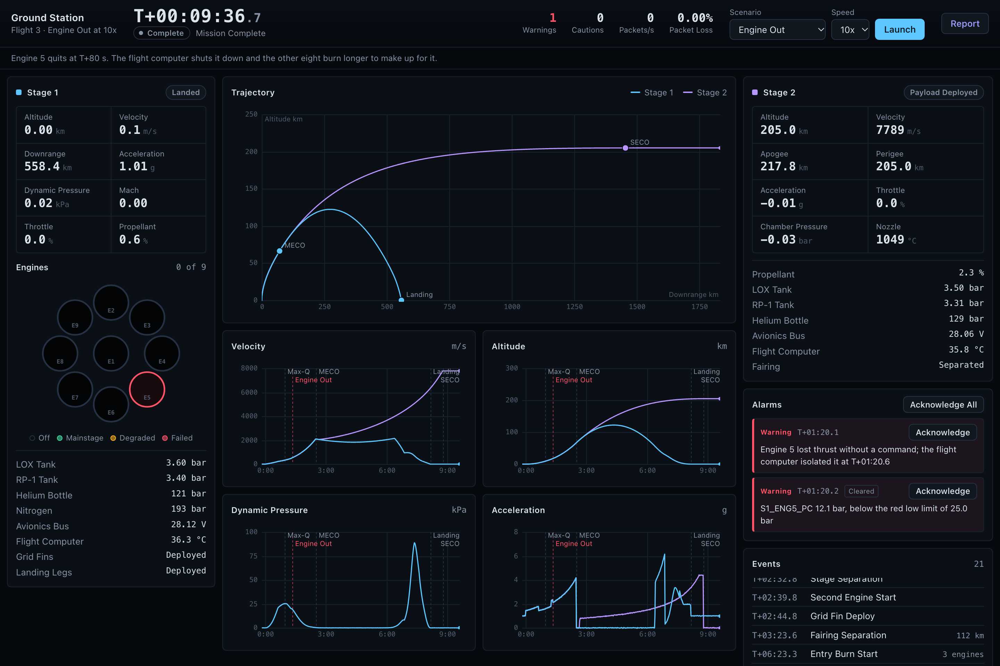
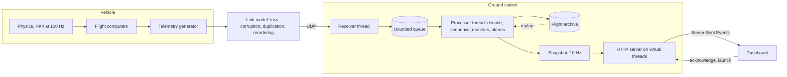

# Telemetry Ground Station

  

A ground station for a simulated two-stage launch vehicle, written in Java 21 with no runtime dependencies.

The simulator flies a full mission, from terminal count to orbit insertion and a booster landing, and sends its telemetry over UDP as CCSDS space packets. The ground station decodes every packet, tracks sequence gaps, checks each channel against a telemetry dictionary, raises and clears alarms, archives the raw stream, and serves a live mission-control dashboard.



*An engine-out flight. Engine 5 failed at T+80 s and the ground flagged it 0.1 s later. The other eight engines burned longer to make up for it, and the second stage reached orbit.*

## Quick start

You need JDK 21 or newer.

```bash
./gradlew run
```

Open http://localhost:8080. A nominal flight starts right away. Use the Scenario picker to launch the others.

To build the jar and run it yourself:

```bash
./gradlew build
java -jar app/build/libs/groundstation.jar demo --scenario helium-leak --speed 5 --open
```

The simulator and the ground station can also run as separate processes, on separate machines if you like:

```bash
java -jar app/build/libs/groundstation.jar ground --udp 5600 --http 8080
java -jar app/build/libs/groundstation.jar sim --host 127.0.0.1 --port 5600 --fault engine-out:7@95 --loss 0.02
```

The ground station records every flight to `flights/`. You can play a recording back into the dashboard or print its post-flight report:

```bash
java -jar app/build/libs/groundstation.jar replay flights/flight-20261010-145332-3.tlm --speed 10 --open
java -jar app/build/libs/groundstation.jar report flights/flight-20261010-145332-3.tlm
```

`java -jar app/build/libs/groundstation.jar help` lists every command and option.

## Architecture



The code is split into four Gradle modules:

| Module | What it holds |
| :--- | :--- |
| `protocol` | The packet format, CRC, telemetry dictionary, encoder and decoder. Everything else depends on it. |
| `vehicle` | Atmosphere and gravity, the vehicle and its engines, both flight computers, fault injection, the telemetry generator and the link model. |
| `ground` | The receiver, the processor and its monitors, alarms, history, the archive, the HTTP server and the dashboard. |
| `app` | The command line. |

## The packet format

Every packet is a CCSDS space packet with a time-code secondary header and a checksum:

| Bytes | Field |
| :--- | :--- |
| 0 to 5 | Primary header: version, type, secondary header flag, 11-bit APID, sequence flags, 14-bit sequence count, data length |
| 6 to 11 | Spacecraft time as a CCSDS unsegmented time code: 4 bytes of seconds and 2 bytes of 1/65536 s |
| 12 to n-2 | Channel values, big-endian, in dictionary order |
| last 2 | CRC-16/CCITT-FALSE over everything before it |

The decoder checks the declared length against the datagram size and then the CRC, before it reads the APID or anything else in the header. A bit flip in the APID can't route a frame to the wrong decoder, because that frame never gets that far. It counts rejected frames by reason: truncated, length mismatch, CRC mismatch, bad header, unknown APID or wrong payload size.

Sequence counts wrap at 16,384. The tracker tells loss, late arrival and duplication apart across the wrap. A reordered packet counts as lost when the gap opens and moves to late when it turns up.

## The telemetry dictionary

The packet layouts, channel types, units and limits all come from one text file, [`dictionary.txt`](protocol/src/main/resources/telemetry/dictionary.txt). The simulator encodes from it, the ground station decodes and checks against it, and the dashboard builds its channel table from it. Adding a channel takes one line.

```
packet 0x102 S1_PROP 25 Stage 1 propulsion
#  name            type class   units  red_lo  yel_lo  yel_hi  red_hi  rate  when          description
   S1_ENG5_MAIN    u8   status  -      -       -       -       -       -     -             Engine 5 in mainstage
   S1_ENG5_PC      f32  sensor  bar    25      34      102     106     -     S1_ENG5_MAIN  Engine 5 chamber pressure
   S1_LOX_TANK_P   f32  sensor  bar    2.6     3.0     4.2     4.6     -     -             LOX tank ullage pressure
   S1_COPV_P       f32  sensor  bar    40      60      -       -       5     -             Helium pressurant bottle pressure
```

The `when` column says when a channel's checks apply. Chamber pressure is only checked while that engine is in mainstage, so engine start and a commanded shutdown don't trip the low limit. The parser reports a bad row by line number and rejects duplicate names and conditions that refer to channels that don't exist.

## Monitoring

All monitors run on the processor thread. None of them read the wall clock: they work from spacecraft time and each frame's receipt time, which is what makes a replay exact.

| Monitor | What it catches | How |
| :--- | :--- | :--- |
| Limits | A reading outside its caution or warning band | Raises after 3 consecutive samples out of limits and clears after 5 back inside, so one noisy sample never raises an alarm. |
| Rate | A reading changing faster than it physically should | Least-squares slope over the last second, against the dictionary's `rate`. Raises once the slope has stayed too steep for 0.5 s. |
| Flatline | A transducer that has frozen | 40 bit-identical samples in a row from a sensor channel. Real sensors always carry noise. |
| Engine health | An engine falling behind the others | Compares each running engine's chamber pressure with the median of all running engines. Below 92% is a caution and below 50% a warning. Pressure that drops while the engine is still in mainstage marks the loss as uncommanded. |
| Staleness | A packet stream that has gone quiet | A packet type is stale after three missed periods. One that stays quiet for two seconds raises a caution, and when all of them have been quiet for three seconds it becomes loss of signal. |
| Derived events | Max-Q and orbit insertion | Worked out on the ground from the telemetry rather than reported by the vehicle. |

An alarm stays on screen until it has both returned to normal and been acknowledged. One that has returned but hasn't been acknowledged is marked Cleared.

## Scenarios

Every scenario but `nominal` injects one fault. The times in the right-hand column come from the test suite's seeded flights, and the tests check them on every build.

| Scenario | Fault | What the ground sees |
| :--- | :--- | :--- |
| `nominal` | None | No alarms. Every milestone from liftoff to payload separation, and the booster lands. |
| `engine-out` | Engine 5 loses chamber pressure at T+80 s | Warning at T+80.1, half a second before the flight computer shuts the engine down. The other eight burn longer and the second stage still makes orbit. |
| `engine-degraded` | Engine 3 loses 12% of its chamber pressure at T+60 s | Caution from the engine health monitor. No reading ever leaves its limits, so limit checking alone would never see it. |
| `helium-leak` | The stage 1 helium bottle leaks from T+45 s | Rate alarm on the bottle at T+45.9. Tank pressure doesn't cross a limit until T+80, so the rate check gives about 34 s of warning. |
| `stuck-sensor` | The stage 2 LOX tank pressure transducer freezes at T+300 s | Flatline alarm at T+301.6. The frozen value is a normal one, so no limit would catch it. |
| `noisy-link` | 3% packet loss with corruption, duplication and reordering | Measured loss of about 3.6% and several hundred CRC errors and duplicates, with no false alarms. |

`sim --fault` takes the same faults with your own targets and times, and `--loss`, `--corrupt`, `--duplicate` and `--reorder` damage the link for any scenario.

## The flight

The simulator integrates a point mass in an Earth-centred inertial frame with fourth-order Runge-Kutta at 100 Hz. It uses the US Standard Atmosphere 1976 and a drag coefficient that varies with Mach number.

The nine first-stage engines spool up with a lag, and the vehicle isn't released until all of them are in mainstage. It pitches over into a gravity turn, throttles down through max-Q and holds acceleration to 4.2 g. At main engine cutoff the booster still has 26 t of propellant, which it keeps for landing.

After separation the booster deploys its grid fins and flies an entry burn to slow down. It lights again for landing using a constant-deceleration guidance law that allows for drag, and touches down on a ship about 560 km downrange. The second stage steers with closed-loop guidance toward a 205 km orbit and cuts off once perigee is above 200 km.

Chamber pressure follows thrust, with noise that grows with pressure. Helium keeps the tanks pressurized until the bottle runs low. The nozzle extension heats with throttle and cools after cutoff, the avionics bus sags under gimbal load, and the flight computers warm up over the flight.

When an engine loses pressure, the stage 1 computer waits half a second to confirm it, shuts the engine down and flies the rest of the burn on eight. With the same seed, a flight produces the same bytes every time.

## Threading

One thread reads datagrams, stamps each with its receipt time and offers it to a bounded queue of 65,536 frames. If the processor ever falls that far behind, the receiver drops and counts frames instead of stalling the socket.

A second thread owns all flight state: decoding, sequence tracking, monitors, alarms, history and the archive. Nothing on the hot path takes a lock. When you acknowledge an alarm or start a new flight from the dashboard, the command goes through a queue to this same thread.

Every 100 ms the processor publishes an immutable snapshot. Each browser connection runs on a virtual thread that waits for the next snapshot and sends it as a Server-Sent Event, along with any chart rows that browser hasn't seen yet. A browser that reconnects mid-flight gets the history it missed.

## Recording and replay

The archive stores every frame as it arrived, corrupted ones included, with its receipt time. The format is an 8-byte magic number followed by records of an 8-byte time, a 2-byte length and the datagram.

Because the monitors run on recorded time rather than the wall clock, a replay reaches the same alarms at the same moments. A test flies the engine-out scenario, records it, replays the recording, and checks that the two post-flight reports are identical down to the byte. This is the report for the flight in the screenshot:

```
Flight report  Engine Out at 10x

Telemetry
  94,760 frames from T-00:15.0 to T+09:36.7
  Lost 0 (0.00%)   CRC errors 0   Malformed 0   Duplicates 0   Late 0

Timeline
  T-00:15.0  Terminal Count
  T-00:03.0  Engine Ignition        9 engines
  T+00:00.0  Liftoff
  T+00:38.0  Throttle Down          80%
  T+00:58.9  Max-Q                  25.4 kPa, seen by ground
  T+01:16.0  Throttle Up            100%
  T+01:20.6  Engine Shutdown        engine 5
  T+02:29.7  Main Engine Cutoff     26.0 t propellant left
  T+02:32.7  Stage Separation
  T+02:39.8  Second Engine Start
  T+02:44.7  Grid Fin Deploy
  T+03:23.6  Fairing Separation     112 km
  T+06:23.3  Entry Burn Start       3 engines
  T+06:52.3  Entry Burn End         950 m/s
  T+07:35.9  Landing Burn Start     5.0 km
  T+07:57.6  Landing Leg Deploy     600 m
  T+08:09.4  Touchdown              2.4 m/s
  T+08:46.2  Second Engine Cutoff   perigee 200.9 km
  T+08:47.4  Orbit Confirmed        perigee 205.0 km, seen by ground
  T+09:26.2  Payload Separation     13.0 t
  T+09:36.2  End of Mission

Alarms
  T+01:20.1  WARNING  Engine 5 lost chamber pressure: 32.8 bar against a median of 96.9 bar across the running engines
  T+01:20.2  WARNING  S1_ENG5_PC 12.1 bar, below the red low limit of 25.0 bar

Outcome
  Stage 2    orbit 205 x 218 km
  Stage 1    landed at 2.4 m/s, 558 km downrange
  Max-Q      25.4 kPa at T+00:58.9
  Peak load  4.18 g on stage 1 ascent, 4.43 g on stage 2
```

## Performance

`groundstation bench` flies a noisy-link mission into memory, 91,073 packets with the corrupt ones included, and runs it through the decoder alone and then through the full processor with every monitor running. On an Apple M4:

| Stage | Throughput | Per packet |
| :--- | ---: | ---: |
| Decode and CRC | 9.9 million packets/s | 0.10 µs |
| Full pipeline | 4.4 million packets/s | 0.22 µs |

A live flight sends about 156 packets a second, so the processor sits idle almost all the time. In a live session, the time from the socket to the end of processing is about 13 µs at the median and 76 µs at the 99th percentile.

## Tests

```bash
./gradlew build
```

The build treats every lint warning as an error and runs 42 tests:

| Area | What the tests check |
| :--- | :--- |
| Protocol | The CRC check value, the bit layout of the primary header, round trips, a single flipped bit anywhere past the primary header, dictionary parse errors |
| Atmosphere | Values against the standard tables |
| Flight | Reaching orbit and landing the booster, event order, surviving an engine failure, packet rates, byte-for-byte determinism |
| Ground | Sequence tracking across the 14-bit wrap, limit persistence and acknowledgement, every scenario flown end to end, replay against live processing, a real UDP socket feeding the event stream |

## License

[MIT](LICENSE)
